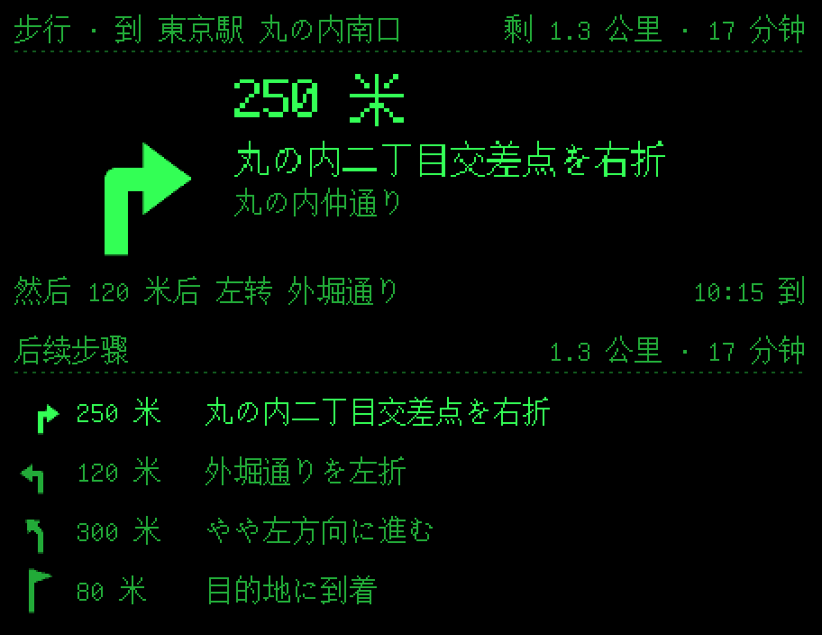
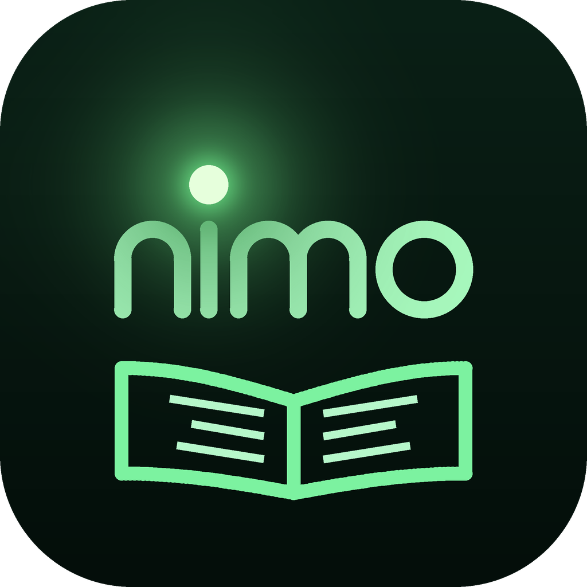
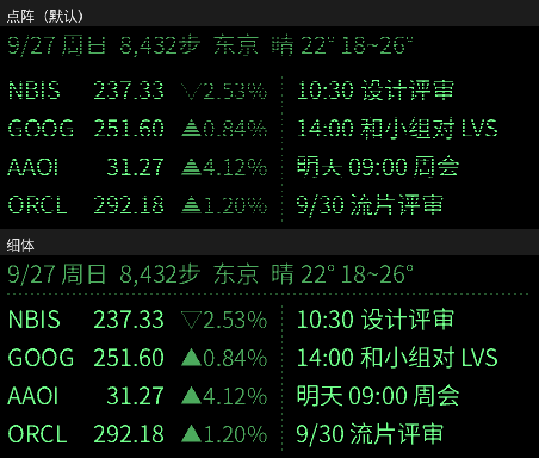

# NimoGo —— 戴着 Nimo 走出去

Nimo 智能眼镜的非官方海外版伴侣 app：用 Google 导航，在日本等海外地区也能导航，转向箭头、距离和路名直接显示在眼镜上。



> 非官方项目，与 Nimo 厂商、Google 都没有关系。个人测试版本，已在 Android 16 实机上跑通。

## 功能

| 功能 | 说明 |
|---|---|
| 导航 | 用 Google Navigation SDK 的逐向导航数据：转向箭头、距离、路名、下一步、剩余距离 / 时间、预计到达时刻显示在眼镜上。步行 / 驾车 / 骑行（不支持公共交通）。单击镜腿切换「当前一步 / 后续步骤」 |
| 小地图 | 眼镜左边画出路线形状、当前位置和下一个转弯点，前进方向朝上，比例尺随转弯距离自动调整。手机放胸前口袋时用指南针，站着转身箭头也跟着转。要转弯、过马路、走岔路的路口用淡的细线画出来（按转向估的形状，不是真实路网：Google 导航不提供周围道路，T 字路口也会画成十字）。「导航设置」里可关 |
| 目的地 | 在 Google Maps 里选好地点 →「共享」→ NimoGo（支持短链接、地点链接、坐标、Place ID、geo: 链接）；也可以在「导航」页直接输入地名（用 Google 地点搜索，中文、日文都行；要启用 Places API (New)，没启用时改用手机系统的地址查询） |
| 计费保护 | Navigation SDK 按目的地计费（每月前 1000 个免费，偏航重算不计）。每次开始前确认；本机按月计数，可设每月上限（默认 1000） |
| 语音跟读 | 提词时眼镜麦克风听你念，手机上离线识别（SenseVoice，中日英），按拼音和讲稿对齐，自动翻到念到的地方；繁体、简体、同音字都对得上，跳句能跟上，讲稿以外的话会停住。正在念的行放在倒数第二行或中间 |
| 戒指 / 演讲模式 | 阅读页里蓝牙戒指、方向键、翻页笔、音量键都能翻：上下翻行，左右翻页。「演讲模式」屏幕全黑但不锁屏，手机放口袋里戒指照常能用 |
| 讲稿 | 「粘贴文字新建讲稿」把剪贴板的文字存成 TXT 并打开（在手机的「下载/NimoGo/讲稿」），也能编辑当前讲稿 |
| 手机离线转文字 | 全天记忆、实时字幕的转文字可以选「手机离线」（SenseVoice，和语音跟读共用模型）：不联网、不要 Key，海外没有网络延迟；也可以用海外的 Groq（有免费额度） |

阅读、看板、通知转发等功能来自萤读，照常可用（说明见文末）。

## 下载和使用

1. 到 [Releases](https://github.com/sherlock202/nimogo/releases/latest) 下载最新的 `NimoGo-vX.Y.Z.apk`，传到手机安装（要允许「安装未知应用」）。
   需要 Android 8.0 以上、有 Google Play 服务。以后的新版可以直接覆盖安装，设置不会丢。
2. 先在系统设置里**强行停止 Nimo 官方 app**（眼镜同一时间只能连一个 app），打开 NimoGo，在「我的 → 连接眼镜」里连接。
3. 导航要用**你自己的** Google Maps Platform API Key（安装包里没有任何 Key，费用记在你自己的 Google Cloud 账号上），步骤见下一节。
4. 在 Google Maps 里选好地点 →「共享」→ NimoGo → 选步行 / 驾车 / 骑行 →「开始」。第一次会弹出 Google 导航服务条款，同意后才能用。

## 准备 Google Maps Platform 的 Key

1. 打开 Google Cloud 控制台，新建项目，**绑定结算账号**（要信用卡；在免费额度内不扣费）。
2. 「API 和服务 › 库」里启用 **Navigation SDK**；想在 NimoGo 里直接输入地名（和 Google Maps 一样中文也能搜），再启用 **Places API (New)**。
3. 「凭据」里创建 API Key，建议加限制：
   - 「应用限制」选 Android 应用，包名填 `io.github.nimogo`，SHA-1 证书指纹填 `59:34:AB:05:09:DC:13:5B:5D:A1:17:35:F5:6E:3F:44:9A:45:92:55`（Releases 里的安装包都用这个证书签名；这是公开的指纹，不是密钥）；
   - 「API 限制」只勾 Navigation SDK（和 Places API (New)，如果启用了）。
   自己用 Android Studio 编译的调试版签名不同，要再加一条那个调试证书的 SHA-1。
4. 建议在「配额」里给 Navigation SDK（和 Places API (New)）设每日上限、在「结算 › 预算和提醒」里设预算提醒。每搜一次地名算一次 Places Autocomplete 请求，有每月免费额度，以 Google 的价格表为准。
5. 装好 app 后在「导航 › 设置 › API Key」里填进去。

## 编译和发布

**方法一：GitHub Actions（不用装开发环境）**
1. 在 GitHub 新建一个仓库（私有也可以），把整个工程上传（`.github/workflows/build.yml` 也要传上去）。
2. 打开仓库的「Actions」页，选「Build APK」→「Run workflow」（推送代码时也会自动编译）。
3. 跑完（约 5～10 分钟）在这次运行的「Artifacts」里下载 `NimoGo-apk`，解压得到 `NimoGo.apk`，传到手机安装（要允许「安装未知应用」）。
4. **建议设置固定签名**（不然每次编译的签名都不同，装新版要先卸载旧版，设置和 Key 会丢）：
   仓库「Settings › Secrets and variables › Actions」里加两个 Secret：`NIMOGO_KEYSTORE_BASE64`（签名文件的 base64）和 `NIMOGO_KEYSTORE_PASSWORD`（密码）。
   设置了就编译正式签名的 Release 版，没设置就编译调试版。签名文件和密码不要放进仓库。

**发布新版本（自动发到 Releases）**
1. 改 `app/build.gradle.kts` 里的 `versionName`（和 `versionCode` 加一），在 `docs/release-notes.md` 里写这一版的说明，提交。
2. 打标签并推送：`git tag v1.1.3 && git push origin main v1.1.3`。
3. Actions 编好后会自动建一个 Release，附上 `NimoGo-v1.1.3.apk`。发布版必须用固定签名（上面第 4 步的 Secrets），没设置会报错停止。

**方法二：Android Studio**（必须用 Android Studio / Gradle）

NimoGo 依赖 Navigation SDK（从 Google Maven 下载），原版的「不用 Android SDK 的命令行脚本」（`tools/build_apk.py`）**不再适用**。

- Android Studio 打开仓库根目录，Gradle 同步后 Run。需要：Gradle 8.13（wrapper 会自动下载）、AGP 8.13.2、Kotlin 2.3.0、compileSdk 36、JDK 17 以上（Android Studio 自带的即可）。
- Navigation SDK 版本 7.9.0（2026-08）。8.0 起要求 AGP 9 / Gradle 9.1 / targetSdk 37，升级时注意。
- `targetSdk` 保持 34：原版界面没适配 Android 15 起强制的全面屏，升上去状态栏会盖住内容。Navigation SDK 文档要求 targetSdk 36，若运行时有问题，先把 targetSdk 改成 36 再试（界面要另外适配）。
- 手机需要 Google Play 服务、2 GB 以上内存；安装包只带 64 位（arm64-v8a）和 x86_64 的原生库。
- 离线识别用 sherpa-onnx：官方只在 GitHub 发布 AAR，第一次编译时 Gradle 会自动下载到 `app/libs/`（不提交到仓库）。识别模型不在安装包里，手机第一次用时从 sherpa-onnx 的 GitHub 发布页下载。

## 开发说明

代码：导航在 `NavLogic.kt`（链接解析、文字、计数，有单元测试）、`NavGuide.kt`（SDK 封装、逐向数据服务、短链接展开）、`NavApp.kt`（眼镜画面和状态），界面在 `MainActivity.kt`。

**实机测试情况**

- 已在 Android 16 实机上跑通：从 Google Maps 共享目的地、Google 导航服务条款、算路线、逐向数据画到眼镜上。
- 开发注意：**调用 Navigation SDK 的任何功能之前，都要先 `NavigationApi.setApiKey`**（见 `NavGuide.useKey`）。
  Key 没写在清单里（免得公开的安装包带着 Key），SDK 第一次被调用时找不到 Key 会直接让 app 崩溃。
- 还要多测的：手机锁屏 / 切到后台时引导是否持续、长距离步行和驾车、偏航重算、到达后的收尾。
- 遇到问题：「导航」页有一行诊断，「我的 › 日志」里有以「导航：」开头的每一步记录；app 闪退后下次打开会弹出闪退记录，可以复制。

**密码和 Key 都不在仓库里**

本仓库可以直接公开，里面没有任何密码、API Key 或签名文件：

| 敏感信息 | 放在哪里 |
|---|---|
| Google Maps Platform 的 API Key | 在 app 里填，只存在手机上（`allowBackup=false`，不进系统备份） |
| APK 签名文件和密码 | GitHub 仓库的 Actions Secrets（`NIMOGO_KEYSTORE_BASE64`、`NIMOGO_KEYSTORE_PASSWORD`）；公开仓库里别人看不到 Secrets，别人 fork 后发来的 Pull Request 也拿不到 |
| 本地 Android Studio 的设置 | `local.properties`，已在 `.gitignore` 里 |

`.gitignore` 已经排除 `*.jks`、`*.keystore`、`*.p12`、`*.pem`、`local.properties`、`.env`、`*Secrets*.txt`、`signing/`。
提交前可以再确认一下：`git status` 里不要出现这些文件；万一把 Key 提交上去了，删提交不够，要到对应的控制台**作废并重新生成 Key**。

**开源许可和署名**

- NimoGo 以 Apache License 2.0 授权，保留萤读、MentraOS 等原作者的署名（`LICENSE`、`NOTICE`）。
- Google Navigation SDK 的版权声明和开源许可：GitHub Actions 编译时从 Google Maven 下载 SDK 的 AAR，把里面的许可文件放进安装包，
  在 app 的「我的 › 关于 › 开源许可」里显示。SDK 的使用受 [Google Maps Platform 服务条款](https://cloud.google.com/maps-platform/terms) 约束。

---

## 附：萤读原说明

> 以下是上游项目 [萤读 Yingdu](https://github.com/codexmasterme/yingdu)（v1.0.3）的原说明，NimoGo 保留了这些功能。其中「安装」「检查更新」「从源码构建 › 方式二」不适用于 NimoGo。

### 萤读 Yingdu —— Nimo 智能眼镜的第三方伴侣 app



取名自「囊萤夜读」：Nimo 的单色绿光显示，像一只停在眼前的萤火虫。

萤读是一个独立的 Android app，通过蓝牙直接控制 **Nimo 智能眼镜**（固件 V0.1.1.4 实测），
在眼镜上看小说、看自己排版的信息看板，并把手机通知弹到眼镜上。翻译和导航交给 Nimo 官方 app（一键切换）。

萤读不申请手机的麦克风权限：需要听声音的功能（全天记忆、实时字幕）只用眼镜自己的麦克风。

> 非官方项目，与 Nimo 厂商无关。协议来自开源项目 MentraOS 的驱动，并在实机上测试过，固件更新后可能失效。

### 功能

| 功能 | 说明 |
|---|---|
| 阅读 | TXT（自动识别 UTF-8 / GBK）、EPUB（读取书内目录，含多级章节）、MOBI / AZW3（无 DRM）；字号 12～32px 每 1px 一档（16px 时一屏 7 行 × 27 字）；自动滚动（每 N 秒前进 M 行）；音量键翻页 / 翻行（在阅读页面里，可用蓝牙翻页戒指）；眼镜的提词器被占用时自动改用图片显示；进度自动保存 |
| 看板 | 卡片插件：股票、日程待办、天气预报、倒数日、世界时钟、像素表盘、番茄钟、今日回顾、附近景点、网络卡片（任意网址）；可开关、排序，两张一屏并排，多屏自动轮换；顶部日期、步数、城市、天气；显示 N 秒后自动收起；跟着眼镜的「抬头显示」：开着抬头显示、低头收起，关着点一下镜腿叫回、右单击收起 |
| 股票 | 雅虎财经搜索、自选列表排序；美股接近实时，含盘前、盘后、夜盘（微牛行情）；日股 / 港股约延迟 15～20 分钟 |
| 日程待办 | 读取手机日历 + app 内待办 |
| 通知 | 读取手机通知，按 app 和时段转发到眼镜自带的通知弹窗（显示 app 图标）；来电提醒；眼镜断线期间的通知连上后补弹；看板和图片阅读上由 NimoGo 画出，默认停留 10 秒、右单击关掉；提词时不打扰 |
| 像素表盘 | 翻页钟（整分钟翻页，有翻到一半的一帧）、数码管（不亮的段微亮，可显示秒）、二进制钟（8421 码，带读数）；全屏或看板卡片 |
| 番茄钟 | 眼镜上 60 格的像素进度环 + 剩余时间；专注 / 短休息 / 长休息时长可调；时间到了眼镜弹提醒、进度环弹一下；后台计时，锁屏不影响 |
| 聚会工具 | 骰子（1～6 个）、抽签（自己写签，抽过不重复）、真心话大冒险（各 30 题）；结果只画在眼镜上，手机和通知栏都看不到 |
| 小游戏 | 2048、贪吃蛇、俄罗斯方块、扫雷、数独、数字华容道、推箱子、五子棋（人机）、记忆翻牌；手机当手柄（方向键 + A、B 键） |
| 眼镜设置 | 息屏模式、抬头显示、自动亮度（和官方 app 一样按眼镜上报的环境光平滑调节）、亮度 |
| 检查更新 | 每天看一次 GitHub 上有没有新版（可关），有新版弹窗问「跳过 / 立即下载」；安装由系统确认，不会后台自动更新 |
| 字体 | 点阵字：16～23px 用 16 点阵（Unifont，字形和眼镜自带界面一致），其余用 12 点阵（Fusion Pixel）放大；逐像素绘制、最近邻缩放，笔画不发糊 |
| 全天记忆 | 只用眼镜麦克风、只在有人说话时录（一直开 / 间歇开麦两种方式）；录音转文字（OpenAI 兼容接口，默认硅基流动 SenseVoice；也支持阿里百炼 Qwen3-ASR-Flash），**转好文字就删录音，手机上只留文字**；分辨自己和别人；每晚用大模型总结（Claude 或 OpenAI 兼容接口）：概要、待办、聊过的事、值得记住的；记忆检索（关键词搜索所有天的文字和回顾，或用大模型直接问）；看板「今日回顾」卡片 |
| 实时字幕 | 眼镜麦克风听到的话转成文字显示在眼镜上，能分出自己说的 |
| 景点介绍 | 按精确位置每 15 / 30 分钟查附近 3 公里的景点（高德地图 / Google 地图，同一景点里的展厅、打卡点只算整体），介绍来自百度百科或维基百科，在眼镜上逐个弹出一屏介绍；看板「附近景点」卡片从近到远列出 |
| 使用手册 | 首页「功能 → 使用手册」：每个功能怎么用、Key 怎么申请、常见问题；设置页右上角「说明」直接跳到对应的一页 |
| 翻译 / 导航 | 一键把眼镜交给 Nimo 官方 app 使用（NimoGo：导航改用自带的 Google 导航） |



### 网络卡片格式

网络卡片会定时请求你填的网址（填了请求体就用 POST，否则 GET；请求头每行一个「名称: 值」），把返回内容显示成看板上的一张卡片：

- **纯文本**：每行一项；用 ` | ` 或 Tab 分成左、中、右三列（中、右两列右对齐）；以 `□ ` 开头的行画成待办方框。
- **JSON**：`{"rows": [...]}` 或直接一个数组，每项可以是字符串、`["左", "中", "右"]`，或 `{"left": "…", "mid": "…", "right": "…", "todo": false}`。

例如接 Home Assistant：网址 `http://家里的地址:8123/api/template`，请求头 `Authorization: Bearer 长期访问令牌`，请求体

```json
{"template": "客厅 | {{ states('sensor.living_room_temperature') }}°\n空调 | {{ states('climate.living_room') }}"}
```

### 安装

到 [Releases](https://github.com/codexmasterme/yingdu/releases/latest) 下载最新版的 apk 安装（Android 8.0+，推荐 Android 12+）。
这是作者自签名的安装包，安装时需要允许"未知来源"。v1.0.3 起萤读会每天检查一次新版，有新版时弹窗问你要不要下载。

**第一次使用：**
1. 用 Nimo 官方 app 配对过眼镜（系统里要有这台已配对设备）；
2. 在系统设置里**强行停止官方 app**（眼镜同一时间只能连一个 app）；
3. 打开萤读，点「连接」，按提示授予蓝牙、通知、定位（天气）、日历、步数等权限。

从官方 app 切回萤读：「我的」→「设备」→「停止官方 app」→ 强行停止 → 返回点「连接眼镜」。

### 从源码构建

#### 方式一：Android Studio（推荐）
用 Android Studio 打开仓库根目录，等 Gradle 同步完成后 Run 即可（AGP 8.5 / Kotlin 1.9 / compileSdk 34）。
注意：Studio 用的是它自己的调试签名，和 Release 里的安装包签名不同，覆盖安装前要先卸载。

#### 方式二：不用 Android SDK 的命令行脚本
作者开发环境里没有 Android SDK，发布版是用下面这套工具链打包的（`tools/`）：
1. `kotlinc` 以 Java 8 字节码编译（`-jvm-target 1.8 -Xlambdas=class -Xsam-conversions=class`，避免 invokedynamic），classpath 用 `android.jar`（API 34）；
2. 用 dex2jar 自带的 `dx` 把 app 的 class 和 Kotlin 标准库转成 `classes.dex`；
3. `python3 tools/build_apk.py out.apk`：用 pyaxml 生成二进制清单（属性按资源 ID 排序，版本号取自 `app/build.gradle.kts`）、`tools/arsc.py` 生成只含图标的 resources.arsc、4 字节对齐、自己实现 APK 签名方案 v2。

眼镜用的点阵字体由 `tools/make_pixel_fonts.py` 从 Unifont 和 Fusion Pixel Font 转换生成（用法见脚本开头），换字体或调整收录范围时重新运行即可。
   签名密钥默认放在 `~/.yingdu/`（第一次运行自动生成）。**不要把密钥提交到仓库。**

### 目录结构

```
app/src/main/java/io/github/yingdu/
  NimoProtocol.kt     帧格式、CRC、分片、图片编码、提词器格式
  NimoClient.kt       蓝牙连接、握手、页面切换、发文字/图片、通知弹窗、眼镜设置
  ReaderService.kt    前台服务：书、看板、股票、天气、步数、日程、通知转发
  MainActivity.kt     界面（纯代码；首页 / 看板 / 我的，功能和设置在一层层的子页面里）
  Book.kt / Formats.kt  TXT / EPUB / MOBI 解析与按行排版
  DashboardImage.kt / ReaderImage.kt / Fonts.kt / PixelFont.kt  眼镜画面绘制（452×170，2bpp，点阵字）
  DashCards.kt        看板卡片（插件）：卡片类型、各卡片内容、网络卡片格式解析、分屏
  Apps.kt             眼镜全屏功能的框架（GlassesApp、画面工具 Frame）
  PhoneIcons.kt       手机首页「功能」的像素图标
  AudioClean.kt       转文字前的录音清理：按说话响度自动调音量、降噪、提前量限幅（有单元测试）
  NoiseReducer.kt     维纳滤波降噪（STFT、按最安静的帧估计底噪、决策导向平滑），转文字用（有单元测试）
  Updater.kt          检查更新：查 GitHub / jsDelivr 上的最新版本、下载并核对 SHA-256（有单元测试）
  Sights.kt           景点介绍：高德 / Google 周边搜索、子点合并、百度百科 / 维基百科介绍、裁成一屏（有单元测试）
  PixelClock.kt / Clock.kt  像素表盘：翻页钟、数码管、二进制钟的点阵画法（有单元测试）/ 全屏表盘
  Pomodoro.kt         番茄钟：计时规则（有单元测试）、进度环画面、到点提醒
  Party.kt            聚会工具：骰子、抽签、真心话大冒险（规则有单元测试）
  Games.kt            小游戏的眼镜画面和手柄操作
  GameLogic.kt        小游戏的规则（不依赖 Android，有单元测试；推箱子每关都验证过有解）
  MicAudio.kt         眼镜麦克风：音频包解析、Opus 解码（Concentus）、Ogg 封装（有单元测试）
  Vad.kt              有没有人在说话（能量高于底噪 + 基频周期性，有单元测试）
  Memory.kt           全天记忆：录音引擎（只用眼镜麦克风）、按天存文字、转完删录音、Ogg → WAV、记忆检索（有单元测试）
  Speaker.kt          分辨自己和别人（音量、音高、低频比例）
  Captions.kt         实时字幕
  MemoryAi.kt         转文字（OpenAI 兼容）、每天总结（Claude Messages API / OpenAI 兼容）
  Stores.kt / Steps.kt / Dashboard.kt / PhoneNotifications.kt / OfficialApp.kt
app/src/main/assets/fonts/  点阵字体（.ydpf）及 OFL 许可证
app/src/test/               协议（与实机收发的帧逐字节比对）和排版的单元测试
tools/                      命令行打包脚本、点阵字体转换脚本、图标生成脚本
samples/                    测试用小说（原创内容，UTF-8 / GBK 两种编码）
releases/                   发布的安装包（下载请到 GitHub 的 Releases 页面）
```

### 致谢与许可

- 协议常量、帧编解码和连接流程移植自 [MentraOS](https://github.com/Mentra-Community/MentraOS)（Apache License 2.0），见 `NOTICE`。
- 字体：16～23px 基于 [GNU Unifont](https://unifoundry.com/unifont/)（SIL OFL 1.1 / GPL 2+ 带字体嵌入例外，双许可，萤读按 OFL 使用），其余字号基于 [Fusion Pixel Font](https://github.com/TakWolf/fusion-pixel-font)（SIL OFL 1.1）；均为子集并转换成萤读自己的点阵格式。许可证见 `app/src/main/assets/fonts/`。
- 眼镜麦克风的 Opus 解码用 [Concentus](https://github.com/lostromb/concentus)（libopus 的纯 Java 移植，BSD 3-Clause），见 `NOTICE`。
- 全天记忆：转文字和总结由用户自己选择服务、填自己的 API Key；录音转好文字就删，手机上只留文字。
- 景点介绍：默认关闭；打开后查询时把当前坐标发给你选的地图服务（高德或 Google）、把景点名发给百度百科 / 维基百科，不发给其他地方。
- 检查更新：每天一次访问 GitHub API 和 jsDelivr 查版本、下载安装包（可以在「关于」里关掉），不带任何个人信息。
- 数据来源：雅虎财经（行情、搜索，非官方接口）、微牛 Webull（美股盘前 / 盘后 / 夜盘，非官方接口）、Open-Meteo（天气、城市搜索）、BigDataCloud（反向地理编码）。

### 许可证

萤读以 [Apache License 2.0](LICENSE) 开源：可以自由使用、修改、再发布（包括商用），
再发布时保留 `LICENSE` 和 `NOTICE`、注明改动即可。眼镜点阵字体按 SIL OFL 1.1 授权（见 `app/src/main/assets/fonts/`）。
「Nimo」是其所有者的商标，萤读是非官方项目，与厂商无关。
